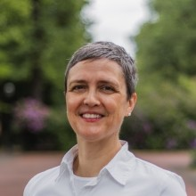

::: {.hero}
```{=html}

```

::: {.hero-text}
```{=html}
<h1 class="hero-name">Jennifer Alix-García</h1>
```

[Professor of Applied Economics · Oregon State University]{.hero-role}

I am an applied microeconomist. My research focuses on environment and development, economic geography, and the impacts of forced migration.

I received my Ph.D. from UC Berkeley's Department of Agricultural and Resource Economics. I have worked at the University of Montana, the University of San Francisco, and the University of Wisconsin–Madison. I am now Professor of Applied Economics and the Hector Macpherson Endowed Professor of Land Economics at Oregon State University.

::: {.profile-links}
[<i class="bi bi-file-earmark-text"></i> CV](files/Alix-Garcia-CV.pdf)
[<i class="bi bi-mortarboard"></i> Google Scholar](https://scholar.google.com/citations?user=I9Dzy94AAAAJ&hl=en)
[<i class="bi bi-person-badge"></i> ORCID](https://orcid.org/0000-0003-0200-0496)
[<i class="bi bi-people"></i> ResearchGate](https://www.researchgate.net/profile/Jennifer_Alix-Garcia2)
[<i class="bi bi-database"></i> Replication packages](https://dataverse.harvard.edu/dataverse/JAlix-Garcia)
:::
:::
:::

## Research themes



## Recent publications



[All publications →](publications.qmd){.more-link}
